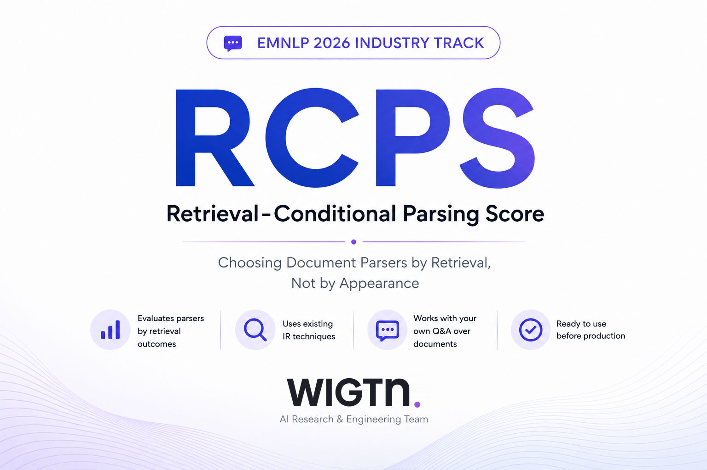
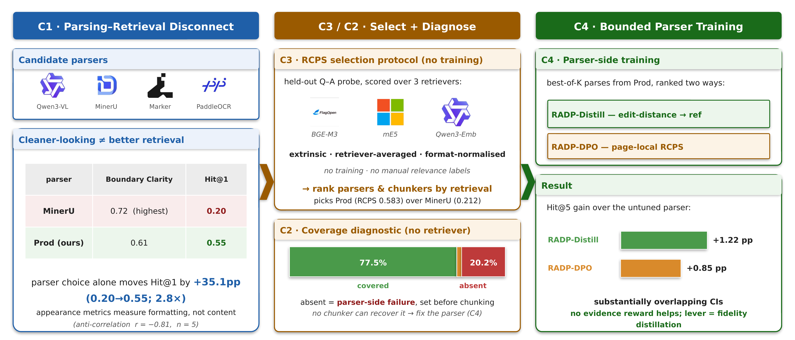
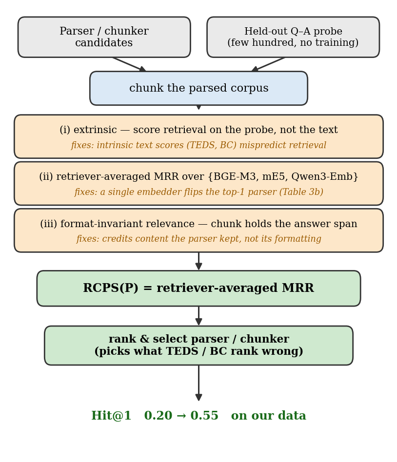
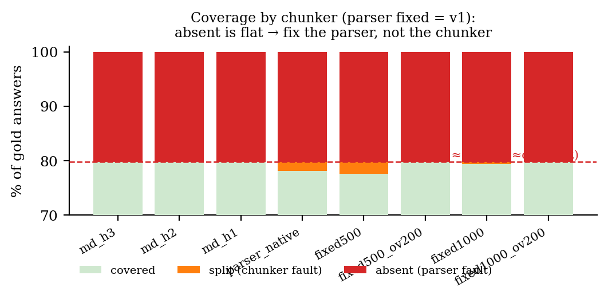
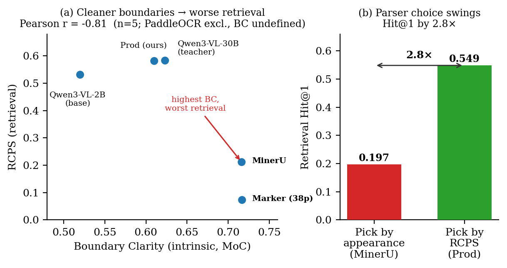

<div align="center">



<br>
<br>

[English](README.md) | [한국어](README.ko.md) | [中文](README.cn.md)

# WigtnOCR-RADP

**RCPS로 검색 기반 선택을 하고 coverage로 진단하며 RADP는 선택적인 파서 학습에만 쓴다.**

[](#라이선스-및-인용)
[](output/pdf/EMNLP2026_Industry_384_camera_ready_final.pdf)
[](https://tech.wigtn.com/rcps/)

[](https://github.com/wigtn/RCPS-RADP-Adapters/releases/tag/v1.0.0)
[](pyproject.toml)
[](LICENSE)

</div>

---

> ✅ **EMNLP 2026 Industry Track · Submission #384 · Accepted**
>
> 🖼️ OpenReview에는 현재 <strong>Accept (Poster)</strong>로 기록돼 있다. 발표 형식 배정은 잠정적이며 oral로 배정될 가능성도 남아 있다.
>
> 📄 제목: *Retrieval-Conditional Parsing Score (RCPS): Choosing Document Parsers by Retrieval, Not by Appearance* · [최종 camera-ready PDF](output/pdf/EMNLP2026_Industry_384_camera_ready_final.pdf)
>
> 📦 기반: [WigtnOCR v1](https://huggingface.co/Wigtn/Qwen3-VL-2B-WigtnOCR) + [KoGovDoc-Bench](https://huggingface.co/datasets/Wigtn/KoGovDoc-Bench)
>
> 🧭 [`docs/PAPER_READABILITY_REVIEW_AUDIT.md`](docs/PAPER_READABILITY_REVIEW_AUDIT.md) (camera-ready 감사) · 🗓️ [`docs/CAMERA_READY_PLAN.md`](docs/CAMERA_READY_PLAN.md)

---

## 핵심 요약

문서 RAG는 파서 출력에서 검색하지만 파서는 검색 성능보다 edit distance나 Boundary Clarity(BC) 같은 intrinsic 지표로 선택되는 경우가 많다. **RCPS는 그 대신 고정된 held-out retrieval probe에서 학습 없이 파서–청커 조합의 순위를 매긴다.** 이렇게 얻는 워크플로는 다음과 같다.

1. **RCPS로 선택한다.** 완전한 파서 configuration 5종은 **0.137–0.584 RCPS**에 걸쳐 있다. 감사한 MinerU-on은 Prod보다 BC가 높지만(**0.713 vs 0.610**) Hit@1은 **42.6포인트** 낮다(**0.123 vs 0.549; Prod가 4.47× 높다**). MinerU-off는 제출본 출력 진단으로만 남긴다.
2. **coverage로 진단한다.** Prod 출력에서 reference span의 <strong>20.2%</strong>는 청킹 전에 정규화한 exact match가 없고 시험한 어떤 청커도 <strong>2.3%</strong>를 넘게 split하지 않는다.
3. **필요할 때만 조치하거나 학습한다.** *absent* span이면 파서를 점검하거나 교체하고 *split* span이면 overlap이나 청킹을 바꾼다. 73페이지 파서 학습 pilot은 목표에 미달했고 별도의 post-audit OHR compatibility subset에서 두 RADP-DPO checkpoint는 Prod보다 **+0.95**, **+1.15 Hit@5 포인트** 높을 뿐이다.
4. **변경된 configuration은 다시 평가한다.** `P`나 `C`가 바뀌면 배포 전에 그 결과 corpus를 같은 RCPS 프로토콜로 다시 돌린다. covered로 판정된 configuration은 불필요한 재평가 없이 그대로 진행한다.

분모는 서로 바꿔 쓸 수 없다.

| 분석 | 평가 frame | 역할 |
|---|---|---|
| 파서/청커 선택 | 663 Q–A를 **294페이지**에서 검색 | evidence page 242개 + Q–A가 없는 distractor 52개 |
| 학습/mechanism | 같은 663 Q–A를 **242페이지**에서 검색 | evidence가 있는 페이지만 사용 |
| 사전 지정 pilot | **202 Q–A / 73페이지** | held-out 학습 gate |
| OHR perturbation | **1,043 Law–Manual Q–A** | source-aligned cross-domain 진단 |
| OHR 학습 감사 | **2,036 Q–A / 6개 domain** | post-audit compatibility subset이며 full v2 rerun이 아니다 |

현재 저장소에는 frozen **663-Q–A KoGovDoc-RAG probe**(evidence가 242페이지에 걸쳐 있다), 그 169/73 evidence-page split, portable 294페이지 source map, RCPS 구현, 선별된 결과 산출물, 그리고 평가한 parser-training adapter 9종 전체의 공개 릴리스가 있다. 주 selection 실행은 Q–A가 없는 distractor 페이지 52개를 더해 294페이지 index를 만든다. 전체 fresh-clone 재실행에 필요한 source document는 포함하지 않았고 남은 공개 공백은 모두 아래에 정리했다.

<p align="center">
  
</p>

*Figure 1. RCPS 워크플로.* 294페이지 / 663-Q–A 고정 frame에서 모든 파서–청커 후보를 평가한다. RCPS가 잠정 `P* + C*`를 고르면, 이어서 coverage가 covered, absent, split span을 구분한다. 파서나 청커를 바꿨다면 최종 배포 전에 다시 평가한다. ([벡터 PDF](paper/figures/fig_overview.pdf) · [편집 가능한 PPTX](paper/figures/fig_overview_camera_ready.pptx))

---

## 동기: 파싱 품질과 검색 성능은 같지 않다

감사한 deployment 비교에서 MinerU-on은 Prod보다 BC가 높지만(**0.713 vs 0.610**) Hit@1은 훨씬 낮다(**0.123 vs 0.549**). 별도로 남긴 제출본 출력 MinerU-off 진단은 BC **0.716**, Hit@1 **0.197**이다. 이 configuration들은 table recognition의 인과 ablation이 아니다. 다만 함께 놓고 보면 경계의 겉모양만으로 파서를 고를 때의 운영 위험을 보여 준다.

OHR-Bench, EnterpriseDocBench와 동시기 OCR-for-RAG 연구도 영어 및 기업 환경에서 비슷한 불일치를 보고한다. 이 연구의 기여는 그 관찰을 **RCPS로 선택하고 coverage로 진단한 뒤 필요할 때만 바꾸거나 학습하고, 변경된 configuration은 다시 평가하는** 배포 워크플로로 바꾼 데 있다. 재사용 가능한 파서 선택 프로토콜과, exact-span absence를 chunk-boundary splitting과 구분하는 진단을 결합한 선행 연구는 알지 못한다.

---

## 기여

| | 기여 | 헤드라인 결과 |
|---|---|---|
| **C1** | 파싱↔검색 **불일치**. 정렬된 영어 OHR-Bench subset에서 semantic-noise perturbation은 검색을 낮추지만 BC는 안정적이거나 비단조적으로 변한다. | 감사한 294페이지 BC↔RCPS **r = −0.74**(기술통계); MinerU-on과 Prod의 차이 **42.6 Hit@1 포인트**(0.123→0.549; 4.47×) |
| **C2** | **RCPS**: 학습 없이 파서/청커를 고르기 위한, retriever 평균·format-normalised·held-out-Q–A 기반 **프로토콜**. | 완전한 294페이지 파서는 **0.137–0.584** 범위; Prod를 고정하면 청커 4종은 **0.535–0.593** 범위 |
| **C3** | **retriever-free coverage 진단**: 각 reference span을 *covered / chunk 사이에 split / 정규화한 파서 출력에 absent*로 분류한다. retriever를 돌리기 *전에* 계산할 수 있는 규칙이다. | **20.2% exact-span absent**, 청커 8종에서 일정; split은 최대 2.3%까지 변동 ⇒ 파서 출력을 먼저 점검 |
| **C4** | 파서측 학습에 대한 **범위가 한정된** 정리. pilot은 목표에 미달했고 retrieval-reward 학습은 matched Distill control과 분리되지 않는다. | post-audit 6개 domain OHR compatibility subset에서 Prod 대비 Hit@5: **R2 +0.95 pp**, **R3 +1.15 pp**, **Distill +1.36 pp** (n=2,036) |

---

## 방법

### RCPS: Retrieval-Conditional Parsing Score (C2)

파서는 출력이 얼마나 깨끗해 보이는지가 아니라 *downstream 검색*이 그 출력으로 무엇을 하는지로 채점한다. RCPS는 **새 유사도 함수가 아니라**, 보통의 retrieval MRR을 **(i) extrinsic**(파서 텍스트만이 아니라 held-out Q–A probe로 채점), **(ii) retriever 평균**(지정한 embedder들에 걸쳐 평균), **(iii) format-normalised relevance**(relevant chunk는 출처 페이지에서 나오고 정규화한 answer span을 포함해야 함)라는 세 가지 선택으로 감싼 프로토콜이다.

```
RCPS(P, C; D, R, K) = (1 / |R||K|) · Σ_{r∈R} Σ_{k∈K} MRR@k(r, C(P), D)
```

여기서 `P`는 파서, `C`는 청커, `D`는 고정 held-out Q–A probe다. `R = {BGE-M3, multilingual-e5-large, Qwen3-Embedding-8B}`, `K = {1, 5, 10}`이다. chunk는 출처 페이지가 답의 페이지와 같고 공통 whitespace·Markdown 정규화 뒤 reference span을 포함할 때에만 **relevant**다. 각 질의에서 MRR@`k`는 첫 relevant chunk가 `j ≤ k`위에 나오면 `1/j`, 상위 `k`개 안에 relevant chunk가 없으면 0이며 이 값을 질의 전체에서 평균한다. 평가에는 **학습이 필요 없다**. 레퍼런스 구현은 [`src/wigtnocr_radp/evaluation/`](src/wigtnocr_radp/evaluation/)에 있다.

<p align="center">
  
</p>

*Figure 2. RCPS 평가 프로토콜.* 모든 후보는 같은 probe, 같은 retriever/검색 깊이 명세, 같은 reference-page와 normalised-span 기준 relevance 규칙을 사용한다. RCPS는 표준 MRR을 평균하며 학습이 필요 없다. ([벡터 PDF](paper/figures/fig_rcps_protocol.pdf))

### Coverage 진단: 파서 vs 청커 (C3)

RCPS는 파서 + 청커 + retriever를 함께 채점하므로, 낮은 점수만으로는 *어느* layer가 문제인지 알 수 없다. 파서 출력을 고정하고 청커만 바꾸면서 정규화한 각 reference span을 **covered**, **split**(파싱한 페이지 출력에는 있지만 chunk 사이에 나뉘어 있어 overlap으로 회복할 가능성이 있음), **absent**(정규화한 파서 출력에 exact match가 없어 re-chunking으로는 그 exact span을 복원할 수 없음)로 분류한다. 이 진단은 먼저 살펴볼 layer를 알려 준다. absent match는 실제 누락일 수도 있고 표면형 불일치일 수도 있으며 둘을 구분하려면 case-level 검토가 필요하다. 코드는 [`scripts/evaluation/coverage_diagnostic.py`](scripts/evaluation/coverage_diagnostic.py)에 있다.

<p align="center">
  
</p>

*Figure 3. Prod를 고정한 coverage 진단.* 청킹 전 exact-span no-match 비율은 <strong>20.2%</strong>로 유지된다. 청커를 바꾸면 split만 달라지며 청커 8종에서 split은 최대 <strong>2.3%</strong>다. ([벡터 PDF](paper/figures/fig_coverage.pdf))

### 파서측 학습: 보조 연구 (C4)

coverage 진단이 파서 출력을 가리킬 때 시험한 접근과 control은 다음과 같다.

- **RADP-aux** *(hidden-state 보조 손실, 기준 미달).* `L_total = L_parse + λ·L_contrast`는 파서의 pooled answer-span hidden state와 frozen BGE-M3 임베딩 사이에 InfoNCE를 적용한다. 73페이지 pilot의 최선 추정치도 사전 지정한 성공 기준에 미치지 못한다. 실제 실행한 sweep은 `Qwen/Qwen3-VL-2B-Instruct`에서 adapter를 학습한 뒤 Prod에 적용해 평가했으므로, preference-based variant와 같은 base를 쓴 비교가 아니다.
- **RADP-DPO** *(discrete-output retrieval-reward DPO).* production 파서에서 parse K개를 샘플하고 각각을 `k = {1, 5, 10}`에 대해 평균한 page-local BGE-M3 MRR로 채점해 preference pair를 만든 뒤 **LoRA-toggle reference**(`π_θ` = LoRA on, `π_ref` = LoRA off)로 학습한다. 후보 pool과 negative는 **R1 → R2 → R3**를 거치며 확장된다. 원본 R2 실행 로그로 `beta = 0.1`을 확인했으며 그 portable executed configuration과 source-log hash는 [`docs/provenance/RADP_DPO_R2_EXECUTED_CONFIG.md`](docs/provenance/RADP_DPO_R2_EXECUTED_CONFIG.md)에 기록했다. adapter 9종 전체의 release inventory와 원본/release hash는 [`checkpoint_release_manifest.json`](docs/provenance/checkpoint_release_manifest.json)에 기록했다.
- **RADP-Distill** *(fidelity-based control).* 후보를 page-local BGE-M3 MRR retrieval reward 대신 reference Markdown과의 edit distance로 순위화한다. 정렬된 2,036-Q–A frame에서 Prod 대비 Hit@5 delta는 **+1.36 pp**다. Distill-minus-R2와 Distill-minus-R3의 직접 비교 구간은 모두 0을 포함한다.
- **SimPO** *(reference-free control).* 242페이지 Hit@5 point estimate는 음수지만 두 신뢰구간 모두 0을 포함한다. 이 실행만으로는 어떤 최적화 차이가 그 결과를 만들었는지 분리하지 못한다.

---

## 실험

### 설정

- **KoGovDoc-RAG selection frame**: **663 Q–A** 전체를 **294페이지**(**229 KoGov + 65 arXiv**)에서 검색한다. 답은 그중 242페이지에 있고 나머지 52페이지는 Q–A가 없는 distractor다. Q–A는 `gpt-5.4-2026-03-05`로 생성했고 별도의 LLM 보조 점검이 표본 pair 94/100을 accept했다. 전체 probe를 인간이 검증한 것은 아니다.
- **KoGovDoc-RAG training frames**: DPO/SimPO와 mechanism 분석은 같은 663 Q–A를 **evidence가 있는 242페이지**에서만 검색한다. 사전 지정 pilot은 held-out **73페이지 / 202-Q–A** fold를 사용한다. preference 데이터는 평가셋과 page-disjoint인 별도의 2,667페이지 Prod corpus와 거기서 생성한 6,164 Q–A에서 나온다.
- **OHR-Bench frames**: C1은 **source-aligned Law–Manual Q–A 1,043개**, benchmark 출력 3개, 종속 perturbation 12개(formatting 3개, semantic 9개)를 사용한다. 이 출력들은 독립 파서 15개가 아니다. C4는 정렬이 어긋난 legacy `notes` 행 223개와 현재 parser bundle에 evidence page가 없는 Q–A 5개를 제외한 별도의 **2,036-Q–A / 6개 domain compatibility subset**을 사용한다. 어느 frame도 full v2 rerun을 대신하지 않는다.
- **모델과 채점**: **Prod**는 한국어 문서 파싱용으로 fine-tune한 Qwen3-VL-2B이고 학습한 variant는 LoRA(r=8, α=32)를 사용한다. RCPS는 retriever 3개 × 검색 깊이 3개를 평균한다. 보고한 불확실성은 별도 표기가 없으면 Q–A 수준의 paired percentile bootstrap으로 계산한다.

### C1: 불일치 (KoGovDoc-RAG 평가셋)

완전한 출력이 있는 후보 5종으로 아래 deployment 비교를 구성한다. MinerU-on은 이 비교에 쓴, 감사를 거친 table-enabled configuration이다.

| 완전한 294페이지 deployment 비교 | BC | CS | RCPS | Hit@1 |
|---|:---:|:---:|:---:|:---:|
| Qwen3-VL-30B (teacher) | 0.623 | 3.38 | **0.584** | 0.545 |
| **Prod (ours, 2B)** | 0.610 | 3.07 | 0.583 | **0.549** |
| Qwen3-VL-2B (base) | 0.520 | 3.74 | 0.532 | 0.500 |
| PaddleOCR | — | 3.46 | 0.140 | 0.125 |
| MinerU-on | **0.713** | — | 0.137 | 0.123 |

Boundary Clarity는 완전한 294페이지 deployment configuration 4종(Qwen3-VL-30B, Prod, Qwen3-VL-2B, MinerU-on)에 대해 정의된다. 이들의 BC–RCPS 상관은 **Pearson r = −0.74**다. Marker의 38페이지 결과를 더하면 <strong>r = −0.83 (n = 5)</strong>이다. 두 추정치 모두 기술통계다. PaddleOCR에는 측정된 BC가 없고 Marker는 complete-output 결과가 아니다.

| 제출본/부분 출력 진단 | 범위 | BC | CS | RCPS | Hit@1 |
|---|:---:|:---:|:---:|:---:|:---:|
| MinerU-off (제출본) | 294페이지 | 0.716 | 2.81 | 0.212 | 0.197 |
| Marker | 38페이지 | **0.717** | 3.41 | 0.073 | 0.068 |

MinerU-on과 MinerU-off는 table handling 외에도 다른 점이 있으므로, 두 점수로 table recognition의 인과 효과를 추정할 수 없다. BC는 Boundary Clarity(높을수록 좋음), CS는 Chunk Stickiness(낮을수록 좋음)다.

<p align="center">
  
</p>

*Figure 4. 파싱 품질은 검색 후보의 순위를 잘못 매길 수 있다.* 패널 (a)는 감사한 294페이지 deployment 비교에서 MinerU-on을 사용하고 패널 (b)는 MinerU-on과 Prod를 Hit@1로 비교한다. MinerU-off는 별도로 표시한 제출본 출력 진단이며 table recognition의 인과 ablation이 아니다. ([벡터 PDF](paper/figures/fig_disconnect.pdf))

### C1: 정렬된 perturbation 진단 (cross-domain, OHR-Bench)

정렬된 Law–Manual subset에서 semantic noise는 검색을 낮추지만 BC는 일관되게 반응하지 않는다. clean에서 severe noise로 가면 MinerU RCPS는 **0.595 → 0.265**로 떨어지는 동안 BC는 **0.657 → 0.631**로 비단조적으로 변하고, Qwen2.5-VL RCPS는 **0.545 → 0.497**로 떨어지는 동안 BC는 **0.563** 근처에 머문다. GOT에는 clean 출력이 없지만 mild에서 severe noise로 가면 RCPS는 **0.461 → 0.298**로 떨어지고 BC는 **0.586 → 0.624**로 오른다. 15개 행 전체의 상관은 **r = −0.35**이며 같은 family 안의 variant들이 서로 종속적이므로 기술통계로만 보고한다. 이 제한된 subset으로는 더 넓은 도메인 일반성을 입증하지 못한다.

### C2: RCPS는 파서와 청커의 순위를 매긴다

| Chunker | RCPS | Hit@1 | MRR@10 |
|---|:---:|:---:|:---:|
| md-h3 | **0.593** | 0.556 | 0.613 |
| parser_native | 0.583 | 0.549 | 0.602 |
| LumberChunker | 0.557 | 0.514 | 0.580 |
| fixed500 | 0.535 | 0.491 | 0.560 |

*KoGov 청킹 grid (663 Q–A, Prod 출력, 3-retriever RCPS 평균).* 별도의 MinerU-on deployment 행이 아니라 MinerU-off를 포함하는 제출본 출력 aggregate grid에서 tracked 감사를 한 결과, MRR@{1,5,10}을 평균하는 대신 3-retriever **MRR@10만** 써도 294페이지 파서 5종과 청커 4종 전체의 순서가 그대로 유지된다. 반면 retriever 평균을 빼고 BGE-M3만 쓰면 **1위 파서가 뒤바뀐다**(Prod가 1위; full RCPS는 30B teacher를 1위로 매긴다). 그 밖의 파서 5종 순위는 일치한다(**Kendall τ = 0.80**). format-sensitive ablation은 이를 재구성하는 데 필요한 ranked chunk 목록이 저장되지 않아 보고하지 않는다. 배포 retriever가 고정돼 있으면 그 retriever를 쓰고, retriever가 미정이거나 후보가 거의 동률이면 multi-retriever 평균을 hedge로 쓴다. RCPS는 MRR에 이름만 새로 붙인 것이 아니라 운영 프로토콜이다.

별도의 3-parser end-to-end 확인에서도 Prod의 judged answer accuracy가 가장 높다(**72.5%**; MinerU-on은 **23.8%**, PaddleOCR은 **20.5%**). 하위 두 파서의 순서는 RCPS와 반대이며 같은 GPT-5.4 checkpoint가 답을 생성하고 판정한다. 따라서 이 결과는 전체 순위의 검증이 아니라 1위 선택의 확인으로만 다룬다.

### C3: coverage 진단은 출력 부재와 chunk 경계를 구분한다

Prod 출력(294페이지: **229 KoGov + 65 arXiv**; 663 Q–A, **retriever 없음**)에서 정규화한 reference span의 <strong>134/663 (20.2%)</strong>는 파서 출력에 exact match가 없고 chunk 사이에 split된 span은 최대 <strong>15/663 (2.3%)</strong>다. exact-span absence 비율은 청커 8종 전체에서 일정하므로, re-chunking으로는 이 case들을 exact-span covered로 만들 수 없다. 이 결과는 청커 튜닝보다 파서 출력 점검을 먼저 하라는 쪽을 가리킨다. 다만 이것만으로 답의 의미가 다른 표면형으로 표현된 것이 아니라 완전히 빠졌다는 것을 보여 주지는 못한다.

라벨 견고성도 시험한다. GPT-5.4는 Prod의 exact-match-absent case 중 <strong>56%</strong>를 회복 가능한 surface artefact로 재분류한다. 다만 이 judge는 GPT 계열 Q–A 생성기와 독립적이지 않다. absent case 100개를 parser-masked 방식으로 층화 추출한 별도 표본에서 두 저자는 adjudication 전에 81/100 case에서 독립적으로 일치했다(**κ = 0.615**). adjudication 후 retrieval-unusable 비율은 MinerU-on **42/50 (84.0%)**, Prod **12/30 (40.0%)**, PaddleOCR <strong>19/20 (95.0%)</strong>다. 표본 추출 비율과 MinerU configuration이 서로 달라 모집단 수준의 재현을 주장할 수 없다. sampling manifest, 두 평가 파일, 19건의 adjudication 기록은 저장소 scorer로 독립적으로 재확인했다. 이 자료는 저자 전용 감사 패키지에 보관하며 공개 릴리스에는 위의 aggregate 결과만 보고한다.

### C4: 파서측 학습은 pilot 목표에 미달한다

held-out 73페이지 / 202-Q–A pilot에서 RADP-aux와 RADP-DPO 모두 사전 지정 목표(RCPS 5포인트 이상이면서 95% 신뢰구간 하한이 0보다 큼)를 충족하지 못한다. 이후 OHR 감사에서 원래 결과가 benchmark release를 섞어 썼다는 점이 드러났다. 정렬이 어긋난 legacy `notes` 행 223개와 빠진 evidence page에 묶인 Q–A 5개를 제거하면, tracked 배열에서 다음과 같은 strict 6개 domain compatibility 결과가 나온다.

| Δ vs Prod (pp) | Hit@1 | Hit@5 | Hit@10 | MRR@10 | nDCG@5 |
|---|:---:|:---:|:---:|:---:|:---:|
| RADP-DPO R2 (retrieval reward) | +0.59 | +0.95 | +0.90 | +0.78 | +0.82 |
| RADP-DPO R3 (hard-negative) | +1.46 | +1.15 | +0.90 | +1.30 | +1.28 |
| RADP-Distill (edit-distance control) | +0.98 | +1.36 | +1.47 | +1.12 | +1.16 |

*post-audit legacy compatibility subset, n=2,036, 3-retriever macro, Q–A 수준 paired-bootstrap 재표본 1,000회(seed 42). Hit@5 95% CI는 R2 **[+0.33,+1.54]**, R3 **[+0.31,+2.05]**, Distill <strong>[+0.43,+2.29]</strong>다. Distill−R2는 **+0.41 pp [−0.43,+1.26]**, Distill−R3는 <strong>+0.21 pp [−0.61,+1.05]</strong>다. 이 subset은 버전 감사 뒤에 정의했으므로, 원래의 confirmatory analysis도 full OHR-Bench v2 평가도 아니다.*

탐색적 KoGov fold(242페이지, n = 663)에서 RADP-DPO milestone들의 Hit@5는 +1.96에서 +2.11 pp에 이른다(P[Δ>0] ≈ 0.90; 모든 양측 구간이 0을 포함한다). SimPO의 Hit@5 point estimate는 md-h3에서 **−0.85 pp**, parser-native 청킹에서 **−0.70 pp**이며 두 신뢰구간 모두 0을 포함한다. 이 pooled 분석은 development evidence page 169개와 held-out evidence page 73개를 합친 것이므로 새로운 독립 holdout이 아니다. matched OHR 비교는 retrieval-reward pair selection이 edit-distance pair selection보다 낫다는 것을 보여 주지 않는다.

### C4: 현재 측정으로는 학습 메커니즘을 특정할 수 없다

| Variant | BC ↑ | TextNED ↓ vs reference |
|---|:---:|:---:|
| Prod (ref) | 0.630 | 0.240 |
| RADP-DPO R2 | 0.647 | **0.163** |
| RADP-DPO R3 | — | 0.185 |
| RADP-aux λ=0.1 | 0.652 | 0.423 |

*선별한 242페이지 mechanism 측정. 사용 가능한 R1–R3 측정은 Prod보다 TextNED가 낮고 Hit@5 point estimate가 양수다. 이 축약 표는 R2와 R3를 보여 주지만 TextNED는 이들의 검색 순서를 재현하지 않는다. R3 BC와 이 구조 지표들의 불확실성 추정치는 없다. 이 동시 발생은 사후 관찰이며 fidelity나 boundary 변화가 검색 차이를 일으켰다는 것을 입증하지 않는다.*

---

## 배포 플레이북

1. **intrinsic 지표만이 아니라 RCPS로 파서를 평가한다.** Boundary Clarity는 downstream retriever가 유지하지 않는 순서로 후보 순위를 매길 수 있다. 감사한 MinerU-on–Prod 비교에서 Prod를 선택하면 고정된 KoGovDoc-RAG probe에서 Hit@1이 **0.123 → 0.549**가 된다. 이 수치는 이 후보군에서 얻은 결과이며 보편적인 효과 크기가 아니다. *실무에 가장 큰 영향을 주는 교훈이다.*
2. **coverage 진단을 먼저 돌린다.** exact-span *absence*가 대부분이면 해당 파서 출력을 살펴보고 내용이 실제로 빠졌을 때 파서를 바꾼다. *split*이 대부분이면 청커나 overlap을 조정한다.
3. **파서를 학습한다면 손대지 않은 subset에서 측정하고 fidelity-based baseline을 함께 둔다.** 감사한 DPO checkpoint의 Hit@5 point estimate는 Prod보다 약 1포인트 높지만 Distill 비교는 현재 per-QA 산출물에서 복원할 수 없다.
4. **결론은 확보한 근거 범위 안에 둔다.** 현재 mechanism 결과는 DPO에서 Prod보다 낮은 TextNED가 함께 나타난다는 것을 보여 줄 뿐, 인과 메커니즘을 특정하거나 evidence 유형별 우위를 입증하지 않는다.

---

## 저장소 구조

```
.
├── configs/                  # 실험 config (YAML)
├── src/wigtnocr_radp/
│   ├── qa_generation/        # Q-A 생성
│   ├── evaluation/           # RCPS, chunker, retriever, coverage, Boundary Clarity, bootstrap CI
│   └── training/             # RADP-aux (contrastive) · RADP-DPO · SimPO (LoRA-toggle ref)
├── scripts/
│   ├── training/             # 후보 생성, preference / edit-distance pair, DPO/Distill/SimPO 파이프라인
│   ├── evaluation/           # baseline_grid, chunking_grid, coverage_diagnostic, rcps_protocol_ablation, OHR 체인
│   └── figures/              # 논문 그림 생성기 (disconnect, coverage, RCPS protocol, noise family)
├── experiments/              # RADP-Distill 학습/평가 harness
├── paper/                    # 제출 동결본 + camera-ready 작업 LaTeX + figures
├── data/KoGovDoc-RAG/        # frozen 663-Q–A probe + 169/73 evidence-page split
├── docs/                     # RESEARCH_DIRECTION · TIMELINE · ROADMAP · plans/ · literature_review/
├── output/                   # 선별된 결과 JSON; 아래 산출물 상태 참고
└── tests/
```

> **그림 정본 안내:** camera-ready 정본 자산은 `paper/figures/fig_overview.pdf`, `fig_rcps_protocol.pdf`, `fig_coverage.pdf`, `fig_disconnect.pdf`이며 이 README에 표시한 PNG 파일은 그 웹 미리보기다. Figure 1의 편집 가능한 정본은 `paper/figures/fig_overview_camera_ready.pptx`이며 RCPS 배지는 C2, coverage 배지는 C3이다.

## 로컬 코드 점검 (Linux/WSL CUDA 환경)

```bash
uv sync --extra dev
uv run pytest
uv run python scripts/analysis/source_page_map.py --check data/KoGovDoc-RAG/source_page_map_v1.json
uv run python scripts/analysis/audit_mineru_output_release.py --check output/results/mineru_output_release_audit.json
uv run python scripts/analysis/audit_kogov_training_table.py --check output/results/kogov_training_table_10k_audit.json
uv run python scripts/evaluation/coverage_diagnostic.py --out_dir /tmp/rcps-coverage-check
```

이 명령들은 `pyproject.toml`과 `uv.lock`에 기록된 Linux/WSL CUDA 12.8 의존성 소스를 전제로 한다. 전체 의존성을 대상으로 한 깨끗한 macOS/CPU 설치 경로는 아직 packaging·검증되지 않았다. `pytest`는 tracked unit test와 alignment-gate test를 실행한다. coverage 계산 자체는 CPU만 쓴다. 이 계산의 기본 Prod 출력(`results/kogovdoc/v1_val/predictions/` 아래)과 663-Q–A probe는 tracked 상태다. portable source-page map은 inventory 점검을 지원하지만 coverage 명령이 쓰는 private training-format `data/KoGovDoc-Bench/val.jsonl`에는 reference transcription이 들어 있어 포함하지 않았다. 따라서 이 명령은 **fresh-clone만으로 완결되지 않는다**. 동등한 로컬 입력이 있으면 `--parser_dir`와 `--val_jsonl`로 지정해 쓸 수 있다.

이 명령들은 논문의 모든 실험을 재현하는 것이 아니다. 전체 재실행은 여전히 외부 source document, 일부 파서 출력, embedding cache, 파서 runtime에 의존한다. 빠진 항목은 아래에 명시했다.

### CPU-only artifact·checkpoint 검증

공개한 평가 artifact와 LoRA adapter 9종은 GPU 없이 clean checkout에서 감사할 수 있다.

```bash
RCPS_RELEASE_DIR="$(mktemp -d)"
curl -fL -o /tmp/RCPS-RADP-Adapters-v1.tar.gz \
  https://github.com/wigtn/RCPS-RADP-Adapters/releases/download/v1.0.0/RCPS-RADP-Adapters-v1.tar.gz
tar -xzf /tmp/RCPS-RADP-Adapters-v1.tar.gz -C "$RCPS_RELEASE_DIR"
python3 scripts/release/verify_camera_ready_artifacts.py \
  --checkpoint-dir "$RCPS_RELEASE_DIR"
```

릴리스 tarball의 SHA-256은 `22b4a0d4f5560f4d7c31633a1c885bbe3568a2bef841bfd94bf2407c339f08c6`이다. deterministic builder, 공개 다운로드 manifest, 포함 정책은 [`CHECKPOINT_RELEASE.md`](docs/provenance/CHECKPOINT_RELEASE.md)에 정리했다.

---

## 저자 (OpenReview 및 camera-ready 순서)

**WigtnOCR v1**(Qwen3-VL-2B 문서 파싱 fine-tuning)의 후속 연구다.

1. Sang-Woo Son
2. Hyeong-seob Kim
3. Hyeonsang Kim
4. Hyun-woo Cho
5. Jinmo Kim

저자 명단과 순서는 제출 당시 그대로다. Industry Track chairs는 이 순서를 바꾸지 않고 Hyeong-seob Kim을 교신저자로 지정할 수 있다고 서면으로 확인했다. 따라서 camera-ready PDF는 공통 소속을 **WIGTN, Seoul, Republic of Korea**로 적고 ACL 템플릿의 `Correspondence: harrison@wigtn.com` 줄을 사용한다. 다른 이메일은 확인된 metadata가 있을 때만 추가한다.

---

## 산출물 및 재현성 상태

### 현재 저장소

- **KoGovDoc-RAG probe 파일**: evidence가 **242페이지**에 걸친 663 Q–A와 frozen 169-development / 73-held-out evidence-page split을 포함한다. 논문의 selection frame은 이 242페이지를 Q–A가 없는 distractor 52페이지와 함께 index한다(**294페이지 = 229 KoGov + 65 arXiv**). 그 전체 source-page corpus는 여기에 포함하지 않았다. portable [`source-page map`](data/KoGovDoc-RAG/source_page_map_v1.json)은 머신 로컬 경로나 reference transcription을 드러내지 않고 모든 `val_####` ID를 domain 및 tracked parser-output 파일명에 연결한다. 별도의 LLM 보조 100-pair Q–A 품질 점검 표본과 그 aggregate 94/100 결과도 tracked다. 이 표본의 빈 `verification` 필드는 인간 annotation이 아니다.
- **RCPS 레퍼런스 구현**: [`src/wigtnocr_radp/evaluation/`](src/wigtnocr_radp/evaluation/).
- **선별된 평가 산출물**: aggregate 파서/청커 grid, 정렬된 full-grid 및 audited-training per-Q–A 배열, coverage와 end-to-end 진단, 그리고 Prod, PaddleOCR, MinerU-on, 제출본 출력 MinerU-off 실행의 완전한 294페이지 출력을 포함한다. 회수한 off 출력은 deterministic [`release audit`](output/results/mineru_output_release_audit.json)으로 해당 aggregate와 연결하며 on/off 실행을 통제된 table-recognition ablation으로 취급하지 않는다. 10,000회 재표본 [`KoGov training-table audit`](output/results/kogov_training_table_10k_audit.json)은 tracked MRR 배열에서 Hit@5를 복원해 camera-ready Table 8의 모든 값을 재현한다. 294페이지 full-grid 감사에는 [`fullgrid_perqa_294p.json`](output/results/fullgrid_perqa_294p.json)과 고정 seed 파서/청커 [`ranking-stability`](output/results/rank_stability_parser_rcps_294p.json) 결과가 포함된다. 663개 중 500개를 뽑는 1,000회 추출에서 Prod는 100%의 추출에서 Base와 모든 OCR 파서보다 높았고 전체 청커 순서는 96.1%에서 그대로였다. Raw matching은 두 pool의 순서를 바꾸지 않고 RCPS를 0.024–0.041 낮춘다.
- **정렬된 OHR 감사 산출물**: 1,043-Q–A Law–Manual C1 결과, 정렬된 RADP-Distill per-Q–A 배열, strict 2,036-Q–A legacy compatibility subset의 deterministic derivation을 포함한다. 예전 7개 domain 출력은 provenance를 위해 tree에 남아 있고 [`MANIFEST.legacy-invalid.sha256`](output/results/MANIFEST.legacy-invalid.sha256)에 나열돼 있지만 유효한 camera-ready 근거가 아니다.
- **인간 점검의 aggregate 결과**: 논문에 parser-masked 100-case absent-label 연구 결과(κ = 0.615, raw agreement 81/100, adjudication 후 파서별 비율)를 기록했다. 바탕이 된 sampling, rating, adjudication 기록은 재확인을 마쳤고 저자 전용 감사 패키지에 보관한다.
- **Parser-training checkpoint**: 평가한 LoRA adapter 9종 전체를 [`wigtn/RCPS-RADP-Adapters` 릴리스 `v1.0.0`](https://github.com/wigtn/RCPS-RADP-Adapters/releases/tag/v1.0.0)에 공개했다. tracked [`release manifest`](docs/provenance/checkpoint_release_manifest.json)는 source hash와 portable hash, 학습/평가 base model, executed configuration을 기록한다. 릴리스에는 RADP-aux 설정 4종, RADP-DPO R1–R3, RADP-Distill, RADP-SimPO가 들어 있다.
- **Camera-ready 그림 자산**: Figure 1–4는 vector PDF로 저장했고 README용 PNG preview를 함께 두었다. Figure 1에는 편집 가능한 정본 PPTX도 있다. 컴파일한 논문은 font가 embedded이고 Type 3 font가 없음을 확인했다.
- **옛 metric 격리**: `output/baselines/correlation_v1.json`은 Phase-1의 역사 자료로만 남기며 non-MoC boundary 정의를 사용했다고 표시했다. camera-ready 근거가 아니다.

### 아직 공개하지 않은 항목

- Qwen3-VL-30B와 Qwen3-VL-2B-base의 파서 출력, 그리고 공개된 파서의 정확한 rerun 명령.
- 논문은 full OHR-Bench v2 결과를 주장하지 않는다. 향후 full-v2 실험에는 공식 v2 Q–A와 새 파서·retrieval 실행이 필요하다. 옛 7개 domain / combined-CI / OHR-TextNED 산출물은 quarantine manifest에 분리해 두었다.
- 완전한 BC/CS mechanism 데이터와 정렬된 불확실성 추정치.
- 원본 preference-pair 텍스트와 완전한 원본 학습 로그. 공개 checkpoint 릴리스는 대신 portable executed configuration, 검증된 adapter, 사용 가능한 structured trainer state를 제공한다.
- 외부 데이터, 파서 출력, embedding cache, base model 확보, 머신 종속 runtime 가정 제거를 포함하는 portable **fresh-clone, end-to-end 재현 경로**.

## 라이선스 및 인용

저장소 코드는 **Apache License 2.0**으로 공개한다. 타사 데이터셋과 모델 자산은 각자의 원 라이선스와 이용 조건을 따른다.

```bibtex
@inproceedings{son2026rcps,
  title     = {Retrieval-Conditional Parsing Score (RCPS): Choosing Document Parsers by Retrieval, Not by Appearance},
  author    = {Son, Sang-Woo and Kim, Hyeong-seob and Kim, Hyeonsang and Cho, Hyun-woo and Kim, Jinmo},
  booktitle = {Proceedings of EMNLP 2026 (Industry Track)},
  year      = {2026},
  note      = {Accepted}
}
```
